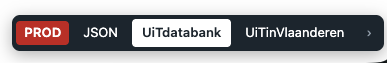

# chrome-plugin-publiq

A small Chrome plugin to easily switch between offers on UiT, UDB and JSON.



On every page of `*.uitdatabank.be` or `*.uitinvlaanderen.be` that shows an event, place or organizer, a bar appears in the bottom right corner with links to the same offer in:

- **JSON**: `io(-env).uitdatabank.be/{type}/{id}`
- **UiTdatabank**: `{env}.uitdatabank.be/{type}/{id}`
- **UiTinVlaanderen**: `{env}.uitinvlaanderen.be/agenda/{e|l|o}/slug/{id}`
- **SAPI**: `search(-env).uitdatabank.be/{type}/?clientId={clientId}&q=id:{id}` (asks for a client id when clicked; it is not stored)

The bar shows the current environment (test, acc or prod) and always links within that same environment. Click the `›` button to collapse the bar.

## Installation

### From a download

1. [Download the latest version](https://github.com/cultuurnet/chrome-plugin-publiq/releases/latest/download/udb-switcher.zip) and unzip it.
2. Open `chrome://extensions` in Chrome.
3. Enable **Developer mode** (toggle in the top right corner).
4. Click **Load unpacked** and select the unzipped folder.
5. Open an event, place or organizer on UiTdatabank, UiTinVlaanderen or the JSON API. The bar appears in the bottom right corner.

To update, download and unzip the new version over the same folder, then click the reload icon on the **UDB Switcher** card in `chrome://extensions`.

### From source

1. Clone this repository:
   ```sh
   git clone https://github.com/cultuurnet/chrome-plugin-publiq.git
   ```
2. Follow steps 2–5 above, selecting the cloned `chrome-plugin-publiq` folder.

To update, run `git pull`, then click the reload icon on the **UDB Switcher** card in `chrome://extensions` and reload any open UiTdatabank or UiTinVlaanderen tabs.

## Releasing

1. Bump `version` in `manifest.json` and commit.
2. Tag and push:
   ```sh
   git tag v1.0.1
   git push origin v1.0.1
   ```

The [release workflow](.github/workflows/release.yml) packages the extension with `package.sh` and attaches `udb-switcher.zip` to a new GitHub release. The download link above always points to the latest release. Run `./package.sh` to build the zip locally in `dist/`.

## Configuration

The hostnames per environment are defined in the `HOSTS` object at the top of `content.js`. The type codes UiTinVlaanderen uses in its URLs (`e`, `l`, `o`) are defined in `UIV_CODE`.

